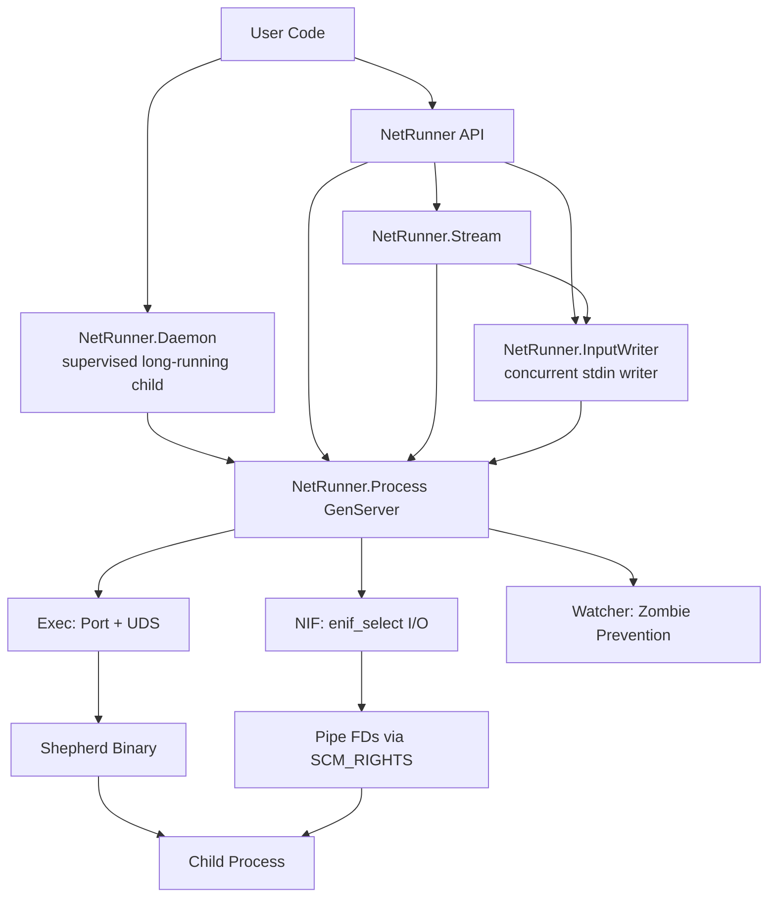
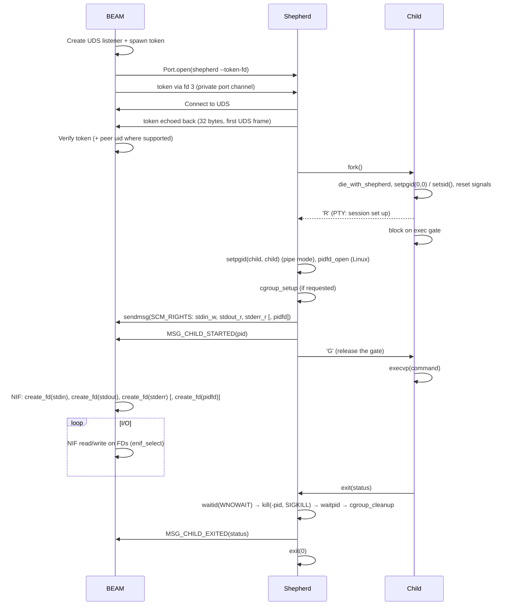
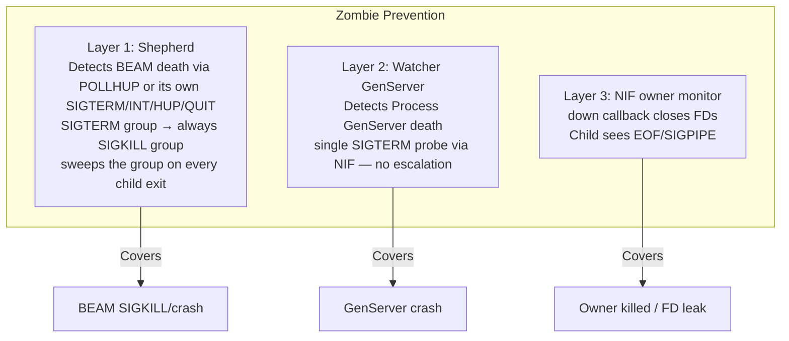

# NetRunner Architecture

## Overview

NetRunner provides safe OS process execution for Elixir by combining NIF-based async I/O with a persistent shepherd binary. This guarantees zero zombie processes, even when the BEAM is killed with SIGKILL.

## Component Diagram



## Process Spawn Sequence



The command is exec'd only after the shepherd has sent the BEAM its fds and pid. On any
shepherd-side failure before the `'G'` byte (cgroup setup, `sendmsg`, the
`MSG_CHILD_STARTED` write) the shepherd closes the gate — the child
`_exit(127)`s without exec — SIGKILLs and reaps it, and only then reports
`MSG_ERROR`. A failed spawn therefore never ran the command, so retrying
it cannot run it twice (ADR-15).

The child also leads its own process group before the BEAM hears of it: in
pipe mode both the child (`setpgid(0, 0)`) and the shepherd
(`setpgid(child, child)`) set it, and in PTY mode the shepherd waits for the
child's `'R'` after `setsid()`. So the BEAM's `killpg` in
`finish_orphaned/2` always has a group to hit; should it still get `ESRCH`,
it falls back to signalling the leader directly.

Before blocking on the gate the child restores every signal disposition to
its default and empties its signal mask: SIG_IGN and the mask survive
`execve`, and the BEAM's launcher (erts ignores SIGFPE and a realtime
signal; `nohup`/`+Bi` ignore SIGHUP/SIGINT) must not decide what the
command can receive.
```

The token never appears on the command line: the shepherd is spawned with
`--token-fd` and reads the 32-byte token from fd 3 — the `:nouse_stdio` port
channel, private to the BEAM and the shepherd (`c_src/shepherd.c`, the
`--token-fd` branch; `open_shepherd/5` + `send_token/2` in
`lib/net_runner/process/exec.ex`). An argv token (`--token <hex>`) would be
world-readable via `/proc/<pid>/cmdline` on Linux and same-uid readable via
`KERN_PROCARGS2` on macOS — visible to exactly the same-uid attacker the
token exists to stop. The shepherd echoes the token as the very first UDS
frame, and the BEAM verifies it before accepting any FDs.

## Zombie Prevention (3 Layers)



**Why all three layers?**

| Layer | Trigger | Mechanism | Covers |
|-------|---------|-----------|--------|
| Shepherd | BEAM process dies; shepherd gets SIGTERM/SIGINT/SIGHUP/SIGQUIT | UDS POLLHUP (after draining queued commands) or self-pipe → SIGTERM group → wait (WNOWAIT) up to `kill_timeout` → **always** SIGKILL group (direct-pid fallback) → reap → cgroup cleanup → `MSG_CHILD_EXITED` when the UDS still works | BEAM SIGKILL, OOM kill, segfault, `systemctl stop`/`kill` of the shepherd |
| Shepherd | Child exits on its own | SIGCHLD → `waitid(WNOWAIT)` → `kill(-pid, SIGKILL)` → reap → cgroup cleanup → `MSG_CHILD_EXITED` | Background members left in the child's group (`sh -c 'worker & exit 0'`) |
| Process GenServer | Shepherd dies without reporting an exit | Port exit → `killpg(child, SIGKILL)` plus a pidfd signal to the leader on Linux (direct kill on `ESRCH` elsewhere), status 137 (`finish_orphaned/2`); on Linux also `PR_SET_PDEATHSIG` in the child | Shepherd SIGKILL/OOM/crash, a child killing its parent |
| Watcher | GenServer crashes | Process.monitor → one SIGTERM probe via NIF | Elixir-level crashes, unhandled errors |
| NIF owner monitor | Owner process dies | `down` callback + destructor close(fd) → child SIGPIPE/EOF | Owner killed without cleanup, FD leaks |

**The group never outlives its leader.** Every shepherd exit path sweeps the
child's process group with SIGKILL *before* reaping the leader: the shepherd
waits for the leader's exit with `waitid(..., WEXITED | WNOWAIT)`, which
leaves it a zombie, and a zombie leader keeps its pid — and so its process
group id — from being reused. `kill(-pid, SIGKILL)` therefore reaches exactly
the child's remaining group members and never a stranger (ADR-14). A
consequence callers can see: background jobs in the child's group die with
it; a job meant to outlive the command must `setsid` itself.

**Exit frame after cleanup.** `MSG_CHILD_EXITED` is sent only after the group
sweep, the reap and `cgroup_cleanup`, so when `await_exit/2` returns the
cgroup leaf is already gone and an immediate respawn on the same
`:cgroup_path` (a `Daemon` restart) cannot hit "already exists". Failure
paths (a `poll()` error, a lost exit frame) report the reaped status whenever
the UDS is still usable instead of leaving the BEAM to `killpg` a reaped,
recyclable pgid.

**Termination signals.** SIGTERM, SIGINT, SIGHUP and SIGQUIT to the shepherd
write a byte to its self-pipe and the event loop runs the BEAM-death ladder,
cleanup included; during spawn they abort the spawn cleanly. Only SIGKILL
(or an OOM kill) can still bypass the shepherd — Layer 2 and
`PR_SET_PDEATHSIG` cover that.

**pidfd (Linux ≥ 5.3).** Right after `fork` the shepherd opens a pidfd for
the child and passes it as the optional last `SCM_RIGHTS` fd. The BEAM wraps
it like a pipe (owner monitor closes it) and uses it for every direct signal
(`nif_pidfd_send_signal`): a pidfd names the process, not a pid number, so a
kill issued after the child was reaped returns `ESRCH` (`{:error,
:not_running}`) instead of hitting a reused pid. It is closed as soon as the
exit status arrives. Without one (macOS, older kernels, seccomp) the BEAM
keeps the probe-then-kill path (ADR-16).

The Watcher deliberately does **not** escalate SIGTERM → SIGKILL
(`lib/net_runner/watcher.ex`): by the time a timed escalation would fire, the
shepherd has usually seen POLLHUP, run its own SIGTERM→SIGKILL ladder and
*reaped* the child — a later `alive?` → `kill` from a process with no reap
authority is a check-then-act race against OS pid reuse and can SIGKILL an
innocent process. Escalation is the shepherd's job (Layer 1); the Watcher's
single probe only covers a shepherd that died before its ladder ran *and*
before the GenServer handled the shepherd's Port exit, where the orphaned
child's pid stays occupied (unreaped) and the probe is safe. The Watcher has
no pidfd: it only acts after the GenServer that owned the pidfd is gone.

The NIF owner-monitor layer is likewise not garbage collection: a NIF resource with a live
`enif_select` registration is never destructed, so the leak safety net is the
owner-process monitor — `io_resource_down` in `c_src/net_runner_nif.c` closes
the fd when the owning process dies without cleaning up; the destructor only
covers resources that were never selected on.

**Threat model.** These layers contain crashing, buggy or careless children.
A child that is adversarial *and* runs under the BEAM's uid can SIGSTOP or
SIGKILL its shepherd, leave its cgroup leaf, ptrace the shepherd (Yama
permitting) or signal the BEAM; containing it needs a separate uid or a
user+cgroup namespace. Within that model the shepherd is non-dumpable on
Linux (`PR_SET_DUMPABLE(0)`), so its memory and environment are not readable
through `/proc` by the same uid without `CAP_SYS_PTRACE`, and `no_new_privs:
true` stops the child from gaining privileges via setuid binaries or file
capabilities.

## I/O Architecture

All I/O goes through the NIF using `enif_select`, which integrates with the BEAM's epoll/kqueue event loop:

1. **Read**: NIF attempts `read(fd)`. If data available, returns immediately. If `EAGAIN`, registers `enif_select(READ)` and the GenServer parks the caller.
2. **Write**: NIF attempts `write(fd)`. Handles partial writes by retrying until `EAGAIN`, then parks.
3. **Ready notification**: BEAM sends `{:select, resource, ref, :ready_input/:ready_output}` to the GenServer, which retries parked operations.

All NIF functions run on **normal** schedulers. Every fd is set to `O_NONBLOCK`
by `nif_create_fd`, so every syscall is bounded and a dirty-scheduler handoff
would be pure overhead — see ADR-6 in `decisions.md` for the measurements.
`nif_read`/`nif_write` call `enif_consume_timeslice` in proportion to the bytes
they moved.

### `:input` is written concurrently with reading

Both `NetRunner.run/2` and `NetRunner.Stream` write stdin from a `Task` that
runs alongside the read loop, sharing one implementation in
`NetRunner.InputWriter`. This is not an optimisation, it is a liveness
requirement: writing input to completion first deadlocks any filter command
whose input exceeds `stdin_buffer + stdout_buffer`. The child fills its stdout
pipe, blocks in `write(2)`, therefore stops draining stdin, and the writer
blocks on a full stdin pipe. Neither side can make progress and `run/2`'s
default `:timeout` is `nil`, i.e. `:infinity`. `run/2` shipped with exactly
this bug until it was fixed; see the CHANGELOG.

The writer closes stdin exactly once, after the last chunk. It is reaped in
one place — joined when the reader reaches `:eof`, killed outright when the
reader halts early — because `Task.async` links, so an abnormal writer exit
already tears the caller down, but a `:normal` one would leave a parked writer
running.

## Spawn Cost: Two `exec`s, by Design

A NetRunner spawn is **two** `fork`+`exec` pairs, not one: the BEAM execs the
shepherd, and the shepherd forks and execs the command. Measured on an idle
Apple M1 Max, OTP 29:

| | |
|---|---|
| one `fork`+`exec` via `System.cmd/2` | 2532 µs |
| one `fork`+`exec` via raw `Port.open({:spawn_executable, …})` | 2655 µs |
| `NetRunner.run(["/usr/bin/true"])` end to end | 4.4–7.2 ms |

So ~5.3 ms is the floor for this design, and NetRunner sits on it. The second
`exec` is not overhead to be optimised away — it *is* the zero-zombie
guarantee, because the shepherd is what stays alive to watch for BEAM death
(ADR-1).

Everything addressable on the Elixir side of the spawn path was measured and
sums to about 1%: `File.dir?/1` 35 µs (0.8%), `:code.priv_dir` resolution 5 µs
(0.1%), `Watcher.watch/2` 6.8 µs (0.2%). The remaining ~87% is the
`:socket.accept` handshake wait, i.e. the shepherd's own `exec`.

**Do not re-open this as a regression.** The only thing that moves it is
amortisation — pooling or reusing shepherds — which is a design project with
real process-lifetime and privilege-boundary questions, not a perf task.
Reproduce with `MIX_ENV=prod mix run bench/exec_baseline.exs` and
`bench/spawn_breakdown.exs`. Note that shell loops are a useless baseline: they
fork a full shell before `exec` and measure ~13.8 ms/iteration.

## PTY Mode

When `pty: true` is passed:
- Shepherd calls `openpty()` instead of `pipe()`
- Child gets a controlling terminal (`setsid()` + `TIOCSCTTY`); the shepherd
  waits for the child's `'R'` byte after `setsid()` before reporting it
- Single bidirectional master FD is sent via SCM_RIGHTS (followed by the
  pidfd on Linux)
- BEAM dups the FD for independent stdin/stdout NIF resources
- `set_window_size/3` sends `CMD_SET_WINSIZE` to shepherd, which calls `ioctl(TIOCSWINSZ)`

## Working Directory

The `cwd:` option has this flow:
- BEAM accepts a non-empty binary without NUL and passes it to the shepherd as
  `--cwd <dir>`
- Shepherd calls `chdir()` after sending its token and before `fork()`
- A failed `chdir()` sends `MSG_ERROR` before the shepherd starts a child
- The UDS and cgroup paths are absolute, so the directory change does not
  affect them
- The directory name is part of the shepherd command line, which any local
  user can read (`ps`, `/proc/<pid>/cmdline`) just like the child's own
  arguments, so it must not contain secrets

See ADR-10 in `decisions.md`.

## Environment

The `env:` option has this flow:
- BEAM validates each name and value and passes them to the `Port.open` `env`
  option
- The shepherd and child inherit the resulting environment
- The values do not appear in the shepherd command line
- The child uses its `PATH` to resolve the executable
- `nil` and `""` both remove a variable
- Names and values must contain valid UTF-8

Replacement mode has two layers. The shepherd gets the selected names as a
`--replace-env` allowlist and, after sending its token, removes every other
variable before `fork()`, so the child's environment does not depend on
timing. The BEAM also unsets, in the port environment, every variable from an
`:os.env/0` snapshot that the caller did not select, so the shepherd itself
normally never holds ambient values such as `RELEASE_COOKIE`. The BEAM
environment does not change.

See ADR-11 and ADR-12 in `decisions.md`.

## cgroup Support (Linux Only)

When `cgroup_path:` is set (a binary under the `net_runner/` prefix, < 256
bytes, no NUL; an unprefixed path is placed under `net_runner/` with a
once-per-VM deprecation warning until 2.0):
- Shepherd creates any missing ancestors (`net_runner/` and intermediate
  components, `mkdir 0755`, `EEXIST` tolerated so sibling spawns do not race)
  and never tears them down. Failure to create one is its own spawn error —
  `"cgroup_setup: cannot create parent cgroup net_runner: Permission denied"`
  on a non-delegated root
- Shepherd creates the leaf `/sys/fs/cgroup/{path}` (`mkdir 0700`). A
  pre-existing leaf is a spawn error — `{:error, {:shepherd_error,
  "cgroup_setup: … already exists; teardown would not be owned"}}` — because
  the shepherd only tears down what it created
- Requires `cgroup.kill` (Linux ≥ 5.14) to be writable in the new leaf;
  otherwise the spawn fails closed, since without it descendants that leave
  the child's process group could outlive teardown
- Moves the child PID to `cgroup.procs` *before* the child `execvp`s (the
  child blocks on a sync pipe until the migration is confirmed); any
  migration failure fails the spawn with the shepherd's diagnostic
- Leaves sub-cgroup creation allowed (container runtimes and harnesses
  nest cgroups); teardown removes them instead
- On cleanup writes `1` to `cgroup.kill` (failure is logged to the
  shepherd's stderr) and removes the directory, recursively removing any
  sub-cgroups first; giving up is logged. Cleanup finishes before
  `MSG_CHILD_EXITED` is sent
- No-op on macOS/BSD: the option is accepted and the child runs unconfined

## Parallelism Model

Every NetRunner process is fully independent:
- Each command gets its own shepherd process, pipe FDs, and GenServer
- NIF functions run on the normal scheduler pool; no dirty-scheduler queue to contend for
- `enif_select` integrates with BEAM's epoll/kqueue — handles thousands of concurrent FDs
- No global lock, no shared process manager
