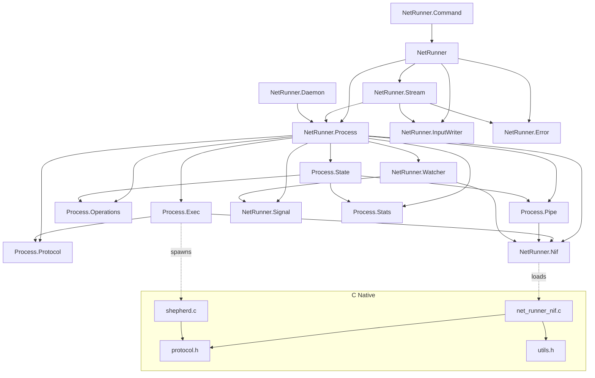

# Module Dependency Diagram

The OTP application (NetRunner.Application) starts no NetRunner module
directly; it supervises `NetRunner.WatcherSupervisor` (a `DynamicSupervisor`
that each Watcher is started under) and `NetRunner.TaskSupervisor`.

## Module Reference

### Public API

| Module | Purpose |
|--------|---------|
| `NetRunner` | Top-level API: `run/2`, `stream!/2`, `stream/2` |
| `NetRunner.Process` | GenServer managing a single OS process lifecycle |
| `NetRunner.Stream` | `Stream.resource` wrapper for incremental I/O |
| `NetRunner.Daemon` | Supervised long-running process for supervision trees |
| `NetRunner.Command` | Reusable command templates with default arguments and options (`use NetRunner.Command`) |
| `NetRunner.Error` | Exception raised by the bang variants (`stream!/2`); the original term is in `:reason` |
| `NetRunner.Process.Stats` | I/O and lifecycle statistics struct returned by `NetRunner.Process.stats/1` |

### Internal Modules

| Module | Purpose |
|--------|---------|
| NetRunner.Signal | Signal atom → platform-specific number resolution via NIF |
| NetRunner.InputWriter | Owns the `:input` writer Task lifecycle for `run/2` and `NetRunner.Stream` |
| NetRunner.Process.Exec | Process spawning: UDS, Port.open, token handshake, SCM\_RIGHTS, FD wrapping |
| NetRunner.Nif | NIF function stubs (@on\_load :load\_nifs) |
| NetRunner.Process.Protocol | Shepherd wire protocol: constants, frame parser, command encoders |
| NetRunner.Process.Pipe | Thin struct around a NIF FD resource |
| NetRunner.Process.State | GenServer state struct |
| NetRunner.Process.Operations | Pending operation queue (park on EAGAIN, retry on ready) |
| NetRunner.Watcher | GenServer started by `NetRunner.Process` under `NetRunner.WatcherSupervisor`; sends one SIGTERM probe when the Process GenServer dies |
| NetRunner.Application | OTP application: starts `NetRunner.WatcherSupervisor` (DynamicSupervisor) and `NetRunner.TaskSupervisor` (Task.Supervisor used by Daemon) |

### C Components

| File | Lines | Purpose |
|------|-------|---------|
| `c_src/shepherd.c` | ~1700 | Persistent child watchdog: token handshake, fork, exec gate, FD/pidfd pass, poll loop, kill escalation, PTY, cgroup |
| `c_src/net_runner_nif.c` | ~810 | NIF: read/write/close/create_fd/dup_fd/kill/kill_group/pidfd_send_signal/signal_number with enif_select |
| `c_src/protocol.h` | ~60 | Shared protocol constants |
| `c_src/utils.h` | ~35 | Debug/error macros |
